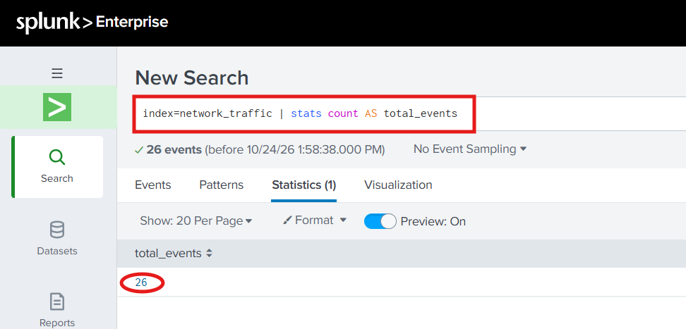
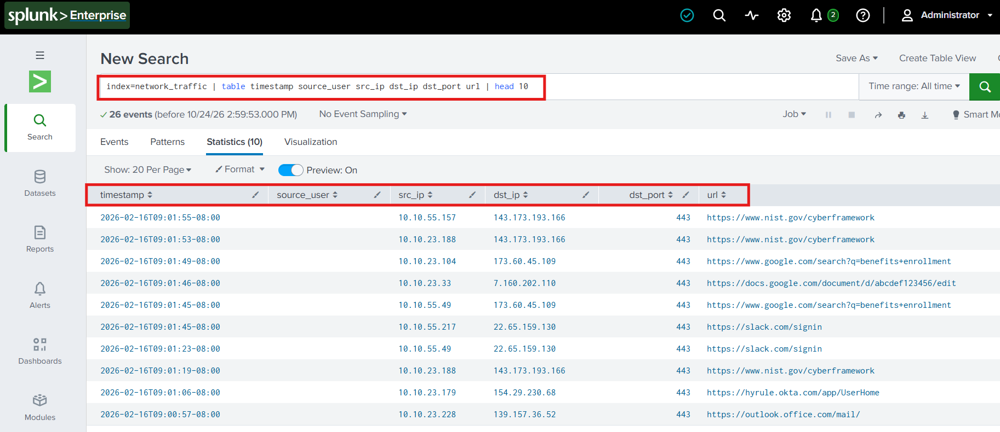
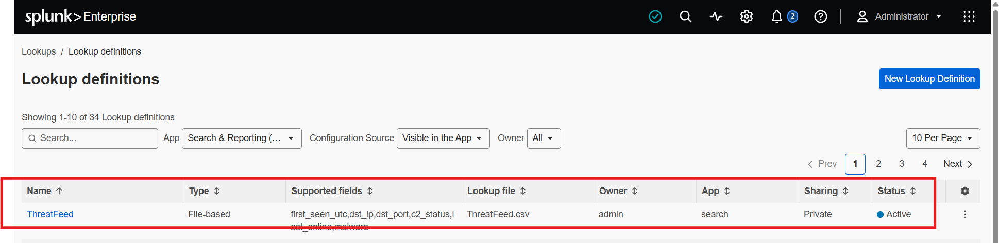
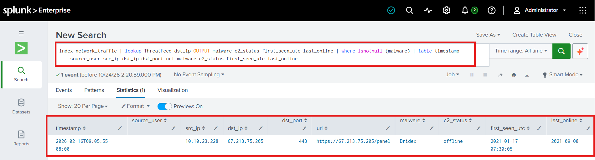
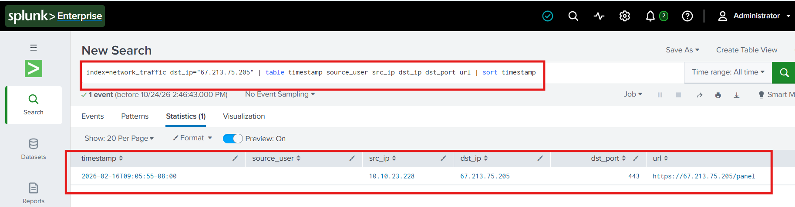

# Splunk Security Log Analysis: Threat Intelligence Correlation

## Project Overview

This project demonstrates a hands-on security log analysis exercise using Splunk Enterprise. Using a provided web proxy log dataset and a threat intelligence CSV file, I imported and inspected network activity, configured a lookup, and searched for destination IP addresses associated with a threat intelligence entry.

The goal was to practice using a Security Information and Event Management (SIEM) platform to investigate potentially suspicious network activity and document evidence-based findings.

## Objectives

- Import and inspect web proxy logs in Splunk Enterprise.
- Identify relevant fields, including source IP, destination IP, destination port, URL, timestamp, and source user.
- Configure a CSV-based threat intelligence lookup.
- Correlate proxy events with threat intelligence data.
- Document investigation findings and recommend appropriate defensive follow-up actions.

## Tools and Data

- **Splunk Enterprise** — Used to ingest, search, and analyze log data.
- **Web proxy logs (`WebProxy01.csv`)** — Course-provided dataset containing 26 events.
- **Threat intelligence feed (`ThreatFeed.csv`)** — Course-provided lookup data containing destination IPs, ports, malware labels, and related threat information.
- **Splunk Search Processing Language (SPL)** — Used to filter, correlate, and display event data.

All analysis was conducted using the provided datasets in a local Splunk environment.

## Investigation Process

### 1. Import and Validate Proxy Logs

Imported `WebProxy01.csv` into the `network_traffic` index and verified that Splunk returned 26 events.

```spl
index=network_traffic
| stats count AS total_events
```

### 2. Inspect Proxy Event Fields

Reviewed the imported events and selected relevant fields for investigation.

```spl
index=network_traffic
| table timestamp source_user src_ip dst_ip dst_port url
| head 10
```

### 3. Configure the Threat Intelligence Lookup

Uploaded `ThreatFeed.csv` as a lookup table and created an active file-based lookup definition named `ThreatFeed`.

The lookup included fields for destination IP, destination port, malware label, command-and-control status, first-seen time, and last-online information.

### 4. Correlate Proxy Events with Threat Intelligence

Compared the destination IP addresses in the proxy events against the threat intelligence lookup.

```spl
index=network_traffic
| lookup ThreatFeed dst_ip OUTPUT malware c2_status first_seen_utc last_online
| where isnotnull(malware)
| table timestamp source_user src_ip dst_ip dst_port url malware c2_status first_seen_utc last_online
```

This search returned one event whose destination IP matched an entry in the lookup and whose associated malware field was populated.

### 5. Investigate the Matching Destination

Searched the proxy dataset for additional events involving the destination IP.

```spl
index=network_traffic dst_ip="67.213.75.205"
| table timestamp source_user src_ip dst_ip dst_port url
| sort timestamp
```

The search returned one event in the dataset involving this destination.

## Findings

The analysis produced the following results:

| Item | Finding |
|---|---|
| Proxy events imported | 26 |
| Events returned by the threat correlation search | 1 |
| Source IP recorded in the event | `10.10.23.228` |
| Destination IP | `67.213.75.205` |
| URL recorded in the proxy log | `https://67.213.75.205/panel` |
| Malware label in the threat intelligence lookup | `Dridex` |
| Source user field | Blank |
| Events involving the destination IP | 1 |

The matching threat intelligence entry associated the destination IP with the malware label `Dridex`.

**Interpretation:** The result identifies a proxy event worthy of further investigation because its destination IP matched an entry in the provided threat intelligence lookup. The available evidence does not independently establish that the source device was compromised, that malware executed, or that credentials were stolen. The source user could not be identified from the matching event because the `source_user` field was blank.

## Defensive Recommendations

Based on the observed match, appropriate follow-up actions would include:

1. **Validate the indicator:** Check the destination IP against current, trusted threat intelligence sources.
2. **Review related activity:** Examine available proxy, DNS, firewall, authentication, and endpoint logs for other suspicious activity involving the source device or destination.
3. **Investigate the endpoint:** Review endpoint security alerts and perform further analysis or scanning if warranted by the broader evidence.
4. **Evaluate containment:** If the indicator is validated and organizational procedures support it, consider blocking the destination IP or URL through appropriate security controls.
5. **Investigate user attribution:** Review additional logs to determine whether the activity can be associated with a specific user.

These are recommendations for further investigation; they are not actions claimed to have been performed in this project.

## Screenshots

### 1. Proxy Data Imported



### 2. Proxy Event Inspection



### 3. Threat Feed Lookup Configuration



### 4. Threat Correlation Results



### 5. Investigation Findings



## Skills Practiced

- SIEM fundamentals using Splunk Enterprise
- Log ingestion and event validation
- Basic SPL searches and field selection
- CSV lookup configuration
- Threat intelligence correlation by destination IP
- Network event investigation
- Evidence-based reporting
- Defensive security recommendations

## Learning Outcome

This exercise provided hands-on practice using Splunk to examine proxy logs, correlate network activity with a threat intelligence lookup, and document a potential security concern. It reinforced the importance of validating indicators and gathering additional evidence before concluding that a security incident or device compromise has occurred.
